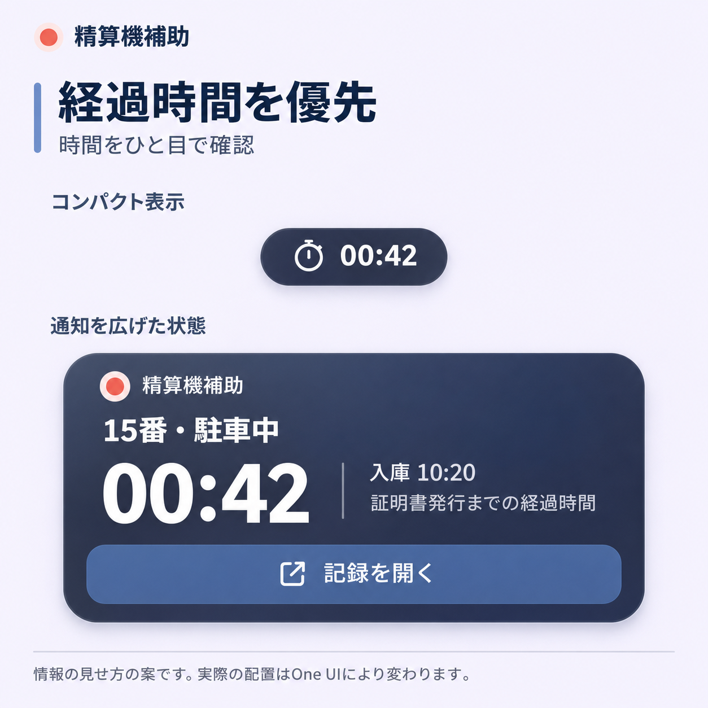
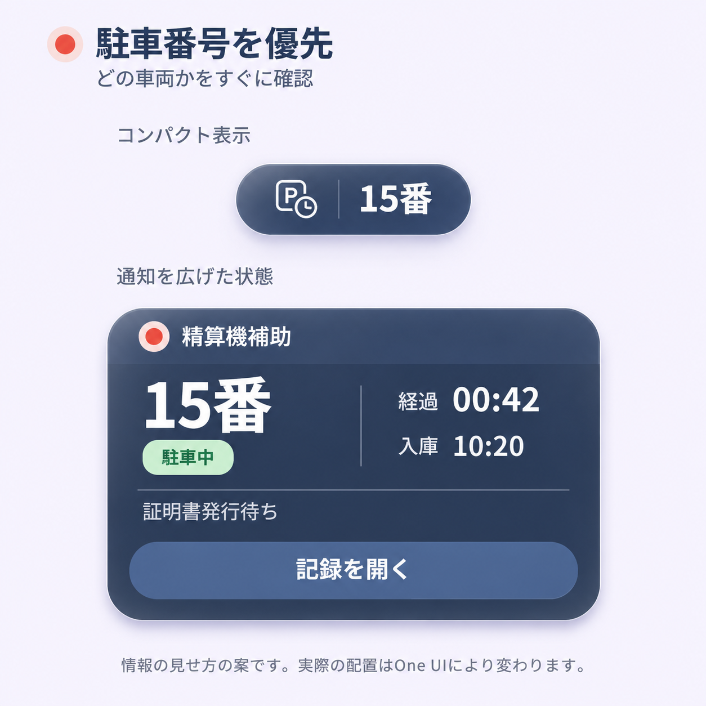

# Now barのUI案（2026年11月25日）

精算機補助のGalaxy向けライブ通知について、情報の見せ方を比較するための3案です。採用案はまだ選んでいません。ここにある画像をもとにした追加のUI実装は、案を決めてから進めます。

画像はProduct DesignのideateとImage Genで作成した検討用モックです。表示している駐車番号や時刻はサンプルで、実際の駐車記録ではありません。現行アプリの青・白と控えめなガラス調を参考にしています。

Now barの枠、文字サイズ、配置、アニメーションなどはOne UIが描画します。画像の見た目をそのままアプリから指定できるわけではありません。実装時は通知のタイトル、本文、経過時間、短い重要テキスト、アプリを開く操作など、公開APIで扱える情報へ落とし込みます。

## 1. 経過時間を優先

コンパクト表示では経過時間を優先します。広げた通知で駐車番号と入庫時刻も確認する案です。

## 2. 駐車番号を優先

コンパクト表示では駐車番号を優先します。広げた通知で経過時間と入庫時刻を確認する案です。

## 3. 複数台をまとめる

コンパクト表示では駐車中の台数を優先します。広げた通知には駐車番号と入庫時刻を一覧で出し、精算待ちの台数を添える案です。複数の経過タイマーを同時に自動更新できることは前提にしていません。

## 次に決めること

採用する案、または各案から組み合わせる部分を選びます。その後にOne UIで表示できる内容を実機で確かめ、必要な追加実装を決めます。

## 参考資料

- [Android公式：Live Updates](https://developer.android.com/develop/ui/views/notifications/live-update)
- [Samsung公式：Now barの使い方](https://www.samsung.com/jp/support/mobile-devices/how-to-use-the-now-bar-on-the-lock-screen-of-your-samsung-galaxy-device/)
