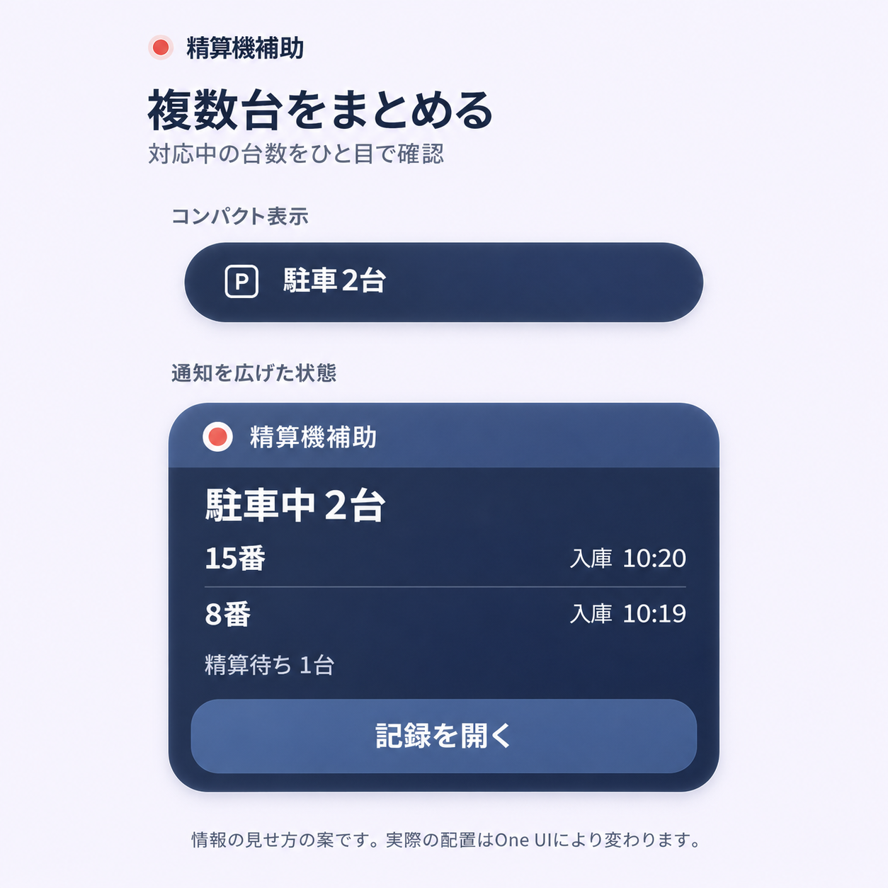

# Now barのUI案（2026年11月25日）

精算機補助のGalaxy向けライブ通知について、情報の見せ方を比較するための3案です。v0.1.32で、1台のときは案1、複数台のときは案3を採用しました。

画像はProduct DesignのideateとImage Genで作成した検討用モックです。表示している駐車番号や時刻はサンプルで、実際の駐車記録ではありません。現行アプリの青・白と控えめなガラス調を参考にしています。

Now barの枠、文字サイズ、配置、アニメーションなどはOne UIが描画します。画像の見た目をそのままアプリから指定できるわけではありません。実装時は通知のタイトル、本文、経過時間、短い重要テキスト、アプリを開く操作など、公開APIで扱える情報へ落とし込みます。

## 1. 経過時間を優先

コンパクト表示では経過時間を優先します。広げた通知で駐車番号と入庫時刻も確認する案です。

## 2. 駐車番号を優先

コンパクト表示では駐車番号を優先します。広げた通知で経過時間と入庫時刻を確認する案です。

## 3. 複数台をまとめる

コンパクト表示では駐車中の台数を優先します。広げた通知には駐車番号と入庫時刻を一覧で出し、精算待ちの台数を添える案です。複数の経過タイマーを同時に自動更新できることは前提にしていません。

## 採用した形（v0.1.32）

- 駐車中が1台：案1。題名は「15番・駐車中」、本文は「入庫 10:20・証明書発行までの経過時間」で、経過時間はOSが自動で進めます。精算待ちがあれば「精算待ち 1台」を添えます。
- 駐車中が2台以上：案3。コンパクト表示は「駐車2台」、題名は「駐車中 2台」です。通知を広げると番号と入庫時刻を1行ずつ出し、最後に精算待ちの台数を出します。
- 精算待ちだけ：昇格させず、通常の継続通知にします。

案2（駐車番号を優先）は、番号未入力で開始した記録だとコンパクト表示が「番号未入力」だけになり、時間も番号も分からないため見送りました。「記録を開く」ボタンは付けず、通知全体のタップでアプリを開きます。

実機のNow barでの見え方は、本人の確認待ちです。

## 参考資料

- [Android公式：Live Updates](https://developer.android.com/develop/ui/views/notifications/live-update)
- [Samsung公式：Now barの使い方](https://www.samsung.com/jp/support/mobile-devices/how-to-use-the-now-bar-on-the-lock-screen-of-your-samsung-galaxy-device/)
